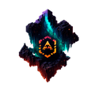
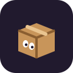
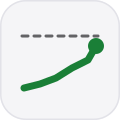
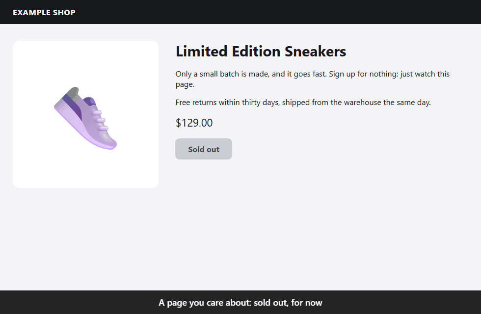
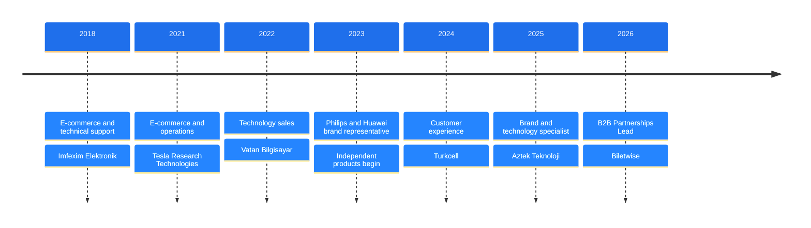

<a href="https://keremalkan.com">
  <picture>
    <source media="(prefers-color-scheme: dark)" srcset="assets/banner-underground.svg">
    <source media="(prefers-color-scheme: light)" srcset="assets/banner-surface.svg">
    
  </picture>
</a>

I know store and e-commerce operations from the inside, and I use that to build **price intelligence for retailers**, **B2B data tools** and free open-source software.

> [!NOTE]
> **Open to roles and consulting.** Write to [contact@keremalkan.com](mailto:contact@keremalkan.com).

- **Now:** B2B Partnerships Lead at Biletwise
- **Building:** Beacon · Data Dent · PageSiren
- **Before:** Brand & Technology Specialist at Aztek Teknoloji, seven global brands (2025–2026)

## Selected work

<table>
<tr>
<td width="72" align="center" valign="top"></td>
<td valign="top"><b><a href="https://beacon.keremalkan.com">Beacon</a></b> · <code>Live</code> 
Price intelligence for retailers. It collects competitor prices seller by seller, flags every price change and keeps the history. The price sync runs on GitHub Actions in a real Chromium browser, because requests from cloud IPs kept hitting bot walls. 
Next.js · TypeScript · PWA · GitHub Actions · Chromium</td>
</tr>
<tr>
<td width="72" align="center" valign="top"></td>
<td valign="top"><b>Data Dent</b> · <code>Desktop</code> · private 
A B2B contact data library for Turkey’s medical and dental market. Designed around Turkey’s data protection law (KVKK): the schema has no column for personal phone or e-mail. It runs on the desktop, and its database is encrypted. 
Rust · Tauri · encrypted SQLite</td>
</tr>
<tr>
<td width="72" align="center" valign="top"></td>
<td valign="top"><b><a href="https://github.com/kerem-alkan/pagesiren">PageSiren</a></b> · <code>Open source</code> 
Stop pressing refresh. Get a siren the moment a page changes: tickets back on sale, a restock, a free appointment slot, an exam result. Free and local: no account, no cloud, no tracking. 
MIT · browser extension · Windows installer · 0 dependencies</td>
</tr>
<tr>
<td width="72" align="center" valign="top"></td>
<td valign="top"><b><a href="https://craftabyss.com">CraftAbyss · Orb</a></b> · <code>Live</code> 
A Minecraft community server, and Orb, a live 3D radar I built to show the server’s status, load and players. The globe at the top of this page is Orb. 
3D · real-time · Minecraft</td>
</tr>
<tr>
<td width="72" align="center" valign="top"></td>
<td valign="top"><b>Haunted Moving Co</b> · <code>In development</code> 
A Roblox co-op comedy about moving house, for 1–4 players. Your furniture has other plans. Made together with a game designer; not released yet, so there is no link. 
Roblox · Luau</td>
</tr>
<tr>
<td width="72" align="center" valign="top"></td>
<td valign="top"><b><a href="https://github.com/kerem-alkan/arise">Arise</a></b> · <code>Experiment</code> 
A small app I made to track my own weight and health. 
PWA</td>
</tr>
</table>

<b>See PageSiren in action</b>

 

## Stack

<b>Web</b>&nbsp;

 
<b>Desktop</b>&nbsp;

 
<b>Data</b>&nbsp;

 
<b>Automation</b>&nbsp;

 
<b>Games</b>&nbsp;

## Experience

I work where two worlds meet: commercial results and the technology that makes them possible.

- **Oct 2026 → now · B2B Partnerships Lead, Biletwise.** Building and running Biletwise’s B2B channel with travel agencies and MICE companies in Turkey, the Gulf, Europe and Asia.
- **Nov 2023 → now · Independent product developer.** My own products: Beacon, Data Dent, PageSiren and Orb.
- **Apr 2025 – Aug 2026 · Brand & Technology Specialist, Aztek Teknoloji.** The first brand representative in a store that had never had one. Took monthly revenue to 9× in November 2025 (+800%) and kept it around 5× after that. Brands: JBL, Harman Kardon, Thule, Marshall, Case Logic, Hama, Skross.

<b>Earlier roles</b>

 

- **Feb – May 2024 · Customer Experience Consultant, Turkcell.** Sales, customer experience and store operations for telecom products and services.
- **Aug – Nov 2023 · Huawei Brand Representative, Hedef Direct.** Huawei’s ecosystem products in MediaMarkt stores.
- **May – Aug 2023 · Philips Brand Representative, KayraGrup.** Philips audio and mobile accessories in MediaMarkt stores.
- **Dec 2022 – Mar 2023 · Technology Sales Consultant, Vatan Bilgisayar.** Sales and product advice for OEM and notebook product groups.
- **Jun – Sep 2021 · E-commerce & Operations Specialist, Tesla Research Technologies.** Product data, stock, competitor price analysis, distributor purchasing and pricing for brands such as Digitus, Eaton, D-Link and Racksys.
- **Sep 2018 – Apr 2021 · E-commerce & Technical Support Specialist, Imfexim Elektronik.** Technical service and after-sales support for Wiky Watch; product data, XML feeds, WooCommerce and T-Soft.

## Contact

[keremalkan.com](https://keremalkan.com) · [LinkedIn](https://www.linkedin.com/in/kerem-alkan/) · [contact@keremalkan.com](mailto:contact@keremalkan.com)

<b>Türkçe</b>

 

Mağaza ve e-ticaret operasyonlarını içeriden biliyorum. Bu bilgiyle **perakendeciler için fiyat zekâsı**, **B2B veri araçları** ve ücretsiz açık kaynak yazılımlar geliştiriyorum.

- **Şu an:** B2B Partnerships Lead, Biletwise
- **Ürünler:** Beacon · Data Dent · PageSiren
- **Önceki:** Marka ve Teknoloji Uzmanı, Aztek Teknoloji · 7 global marka (2025–2026)
- **Durum:** İş ve danışmanlık tekliflerine açığım. Yazın: [contact@keremalkan.com](mailto:contact@keremalkan.com)

**Projeler**

- **[Beacon](https://beacon.keremalkan.com):** Perakendecilere satılan fiyat ve operasyon zekâsı platformu. Rakip fiyatlarını satıcı satıcı toplar, her fiyat değişikliğini işaretler ve geçmişi saklar.
- **Data Dent:** Türkiye’nin medikal ve dental pazarı için B2B iletişim veri kütüphanesi. KVKK’ya göre baştan tasarlandı: şemada kişisel telefon veya e-posta sütunu yok. Masaüstünde çalışır, veritabanı şifrelidir.
- **[PageSiren](https://github.com/kerem-alkan/pagesiren):** Ücretsiz, açık kaynak sayfa değişikliği alarmı. Sayfa değiştiği an siren çalar. Hesap yok, bulut yok, veri toplama yok.
- **[CraftAbyss · Orb](https://craftabyss.com):** Bir Minecraft topluluk sunucusu ve onun için yaptığım 3D radar Orb. Bu sayfanın en üstündeki küre Orb.
- **Haunted Moving Co:** Taşınma temalı, 1–4 kişilik co-op Roblox komedi oyunu. Bir oyun tasarımcısıyla birlikte geliştiriliyor; henüz yayında değil.
- **[Arise](https://github.com/kerem-alkan/arise):** Kendi kilo ve sağlık takibim için yaptığım küçük bir uygulama.

Ayrıntılar: [keremalkan.com/tr](https://keremalkan.com/tr)

 

The banner follows your GitHub theme: light shows the <b>Surface</b>, dark shows the <b>Underground</b>. One skeleton, two materials, the same as on <a href="https://keremalkan.com">keremalkan.com</a>, where the <kbd>&#96;</kbd> key switches worlds.
